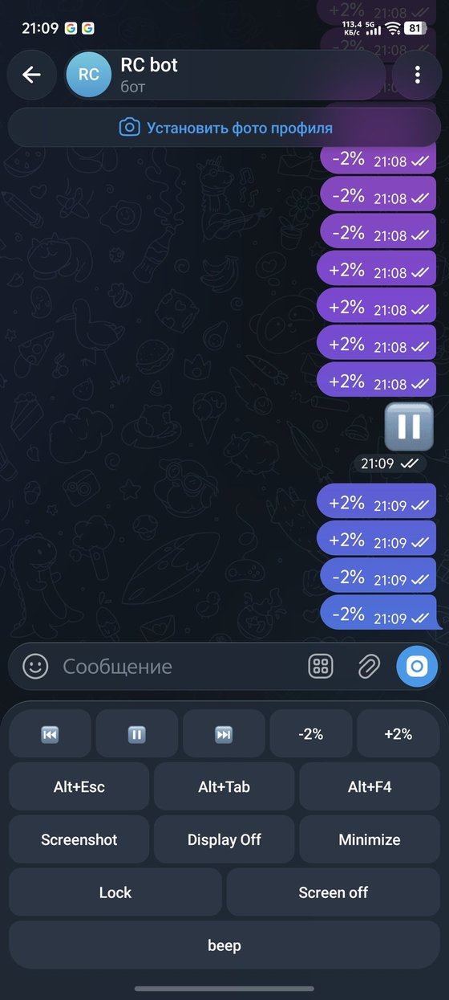
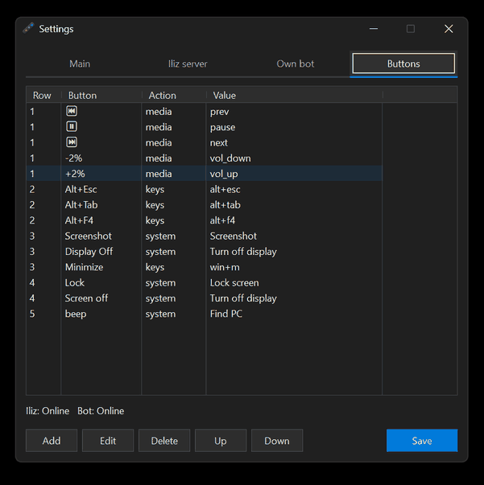

# iliz pcrc

[English](README.md)

Простой и удобный пульт для компьютера на Windows. Очень лёгкий клиент: один exe в трее, без установщика. На телефон ничего ставить не нужно — весь пульт уже есть в Telegram-боте.

С дивана поставить музыку на паузу, отправить сочетание клавиш, заблокировать экран, взглянуть на рабочий стол или проиграть голосовое на колонках. Подходит для компьютера, который остаётся включённым в другой комнате, когда полный удалённый рабочий стол не нужен.

Лицензия MIT.

Весь клиент — это иконка в трее. Правый щелчок: Open Telegram, Open control page, Settings, Open config.json, About, Exit. Двойной щелчок открывает Settings. Другого окна нет, пока вы его сами не откроете.

**Два способа связаться с ПК. Можно один, можно оба сразу.**

- **Iliz server** — готовый бот. Работает сразу после запуска exe: без настроек и без токена BotFather на этом ПК. Клиент сам берёт MQTT у API и открывает `t.me/{бот}?start={token}`. Трей → **Open Telegram**.
- **Own bot** — свой бот. Токен BotFather и список Telegram user ID. Каталог полностью serverless: без нашего облака и без своего сервера. Каталог — это Telegram. Команды выполняются только от этих ID.

Кнопки настраиваются как угодно: медиа, горячие клавиши, запуск программ, система, мышь и ввод текста. До 64 кнопок и 10 рядов — в окне Settings или прямо в `config.json` рядом с exe.





## Возможности

- При первом запуске программа создаёт токен устройства и открывает Settings.
- Иконка в трее: серая, пока включённый транспорт не в сети; обычная, когда все включённые транспорты онлайн; короткая вспышка при команде.
- Кнопки, до 64, до 10 рядов:
  - **media** — предыдущий / следующий трек, пауза, стоп, громкость, mute.
  - **keys** — сочетание клавиш (`ctrl+shift+s`, `alt+f4`, `win+d`). В окне кнопки сочетание снимается с клавиатуры.
  - **run** — открыть файл, программу или URL.
  - **system** — блокировка, сон, выключить монитор, выход из Windows, перезагрузка, выключение, снимок экрана, микрофон, сигнал «найти ПК».
  - **cmd** — текстовая команда (мышь, колесо, ввод текста). См. [Команды](#команды) ниже.
- Перезагрузка и выключение выполняются только после `Yes` в течение 30 секунд.
- Голосовое или аудиофайл в чат бота играет на колонках этого ПК. Новый ролик сменяет тот, что уже играет. Свой бот: только от ID из списка разрешённых. Рядом с exe лежат `bass.dll` и `bassopus.dll`.
- Iliz: снимок уходит в готовый бот. Own bot: снимок уходит в чат.
- Всё управление — из меню иконки в трее. Отдельная панель не нужна.
- Автозапуск с Windows. Галка пишет `HKCU\Software\Microsoft\Windows\CurrentVersion\Run`, значение `IlizPcrc`. Больше в реестре ничего не хранится.
- Повторный запуск exe не плодит копии: открывает Settings уже работающей программы.
- Own bot: `/start`, `/keyboard` и `/help` показывают ваш user ID и обновляют клавиатуру.

Пример раскладки (медиа, горячие клавиши, снимок, блокировка, beep) — в [`defaults/config.json`](defaults/config.json). Секреты в примере пустые. `config.json` рядом с вашим exe — ваш, его публиковать не нужно.

## Требования

- Windows 10 или 11, 64-bit
- Own bot: исходящий HTTPS к `api.telegram.org`
- Iliz server: свой API и MQTT-брокер по обычному TCP
- Для сборки: Visual Studio Build Tools 2022 (MSVC x64)

## Установка

1. Скачайте zip из Releases этого репозитория или соберите сами (см. ниже).
2. Положите `iliz_pcrc.exe` в свою папку. В zip уже есть `config.json`, `bass.dll`, `bassopus.dll` и `beep.mp3`. При сборке из исходников [`defaults/config.json`](defaults/config.json) копируется в `bin\`, если файла ещё нет; две DLL положите рядом с exe сами (`build.bat` их не трогает).
3. Запустите exe. Он сядет в трей. Settings откроется, если токена устройства ещё нет.

Правый щелчок по иконке в трее — меню: Open Telegram, Open control page (когда Iliz включён), Settings, Open config.json, About, Exit. Двойной щелчок — Settings. Это и есть весь интерфейс.

В `config.json` лежат токен устройства, адрес API и токен бота. Логин MQTT приходит из bootstrap и в файл не пишется. Не коммитьте этот файл и не отправляйте его.

### Iliz server

Включён сразу. Запустите exe, дождитесь онлайн у иконки в трее, затем трей → **Open Telegram**. BotFather не нужен, токен вставлять некуда, поля заполнять не нужно.

Клиент отправляет `POST {server}/api/device/bootstrap` и берёт логин MQTT из ответа. Страница управления — `{server}/{token}`.

Имя бота приходит в этом ответе. Если сервер его не прислал, его задаёт поле `telegramBotUsername` в `config.json`.

**New token** выпускает новый токен устройства. Старая страница и ссылка в Telegram перестают соответствовать этому ПК.

Другой адрес API — по желанию: Settings → **Iliz server**.

### Own bot

На телефоне ничего кроме Telegram. Своего сервера нет. Создайте бота, вставьте токен, добавьте свой ID.

1. В Telegram откройте [@BotFather](https://t.me/BotFather).
2. Отправьте `/newbot`, задайте имя и username. Username должен заканчиваться на `bot`.
3. BotFather пришлёт токен вида `123456789:AA...`. Скопируйте его целиком.
4. Settings → **Own bot**: вставьте токен, галка **Enabled**, **Save**.
5. Откройте своего бота и отправьте `/start`. В ответе будет `Your ID: ...`.
6. Вставьте этот ID в **Allowed user IDs**. Несколько человек — через запятую: `111,222`.
7. Снова **Save**. Бот ответит `Ready.` и покажет клавиатуру.

Токен — пароль к боту. Если он утёк, в BotFather выполните `/revoke` и вставьте новый.

Пока список ID пуст, кнопки не срабатывают. Остальным бот отвечает `Not authorized`. Голосовое или аудио от разрешённого пользователя играет на колонках.

## Кнопки

Settings → таблица **Row / Button / Action / Value**. **Add**, **Edit**, **Delete**, **Up**, **Down**, затем **Save**. **Up** и **Down** меняют выбранную кнопку местами с соседней. Если сосед на другом ряду, кнопка переходит в его ряд. Iliz публикует раскладку при **Save**. Своему боту отправьте `/start`, чтобы Telegram обновил клавиатуру.

Трей → **Open config.json** — тот же файл вручную (UTF-8). Публикуемый пример — [`defaults/config.json`](defaults/config.json). Кнопки — массив `buttons`. Короткая схема:

```json
{
  "version": 1,
  "ilizEnabled": true,
  "ownEnabled": false,
  "token": "",
  "server": "http://127.0.0.1:8080",
  "botToken": "",
  "allowedIds": "",
  "buttons": [
    { "row": 1, "label": "⏸", "action": "media", "value": "pause" },
    { "row": 2, "label": "Alt+F4", "action": "keys", "value": "alt+f4" },
    { "row": 3, "label": "Screenshot", "action": "system", "value": "shot" }
  ]
}
```

| action | value |
|--------|--------|
| `media` | `prev` `next` `pause` `stop` `vol_up` `vol_down` `mute` |
| `keys` | `ctrl+shift+s` `alt+f4` `win+d` |
| `run` | `C:\\Tools\\script.bat` или путь / URL |
| `system` | `lock` `sleep` `display` `restart` `shutdown` `signout` `shot` `mic` `beep` |
| `cmd` | строка команды, см. [Команды](#команды) |

Подпись на кнопке (`label`) — это текст, который клиент сравнивает с командой. Две кнопки с одной подписью не различаются.

## Команды

Имя кнопки ищется первым. Если кнопки с таким текстом нет, строка выполняется как команда.

Несколько вызовов в одном сообщении: разделитель `;` или новая строка. Пробелы не важны. Скобки обязательны, даже без аргументов.

Координаты — пиксели экрана (на нескольких мониторах могут быть отрицательными). Без координат действие в текущей точке курсора.

| команда | заметки |
|---------|---------|
| `ping()` | в ответ приходит `pong` |
| `setMousePos(x, y)` | оба аргумента обязательны |
| `leftClick()` / `leftClick(x, y)` | нажать и отпустить |
| `leftDown()` / `leftDown(x, y)` | зажать |
| `leftUp()` / `leftUp(x, y)` | отпустить |
| `rightClick()` / `rightClick(x, y)` | |
| `rightDown()` / `rightDown(x, y)` | |
| `rightUp()` / `rightUp(x, y)` | |
| `scroll(n)` | щелчки колеса в точке курсора, от `1` до `120` вверх, от `-1` до `-120` вниз |
| `type("text")` | вводит текст в окно с фокусом. `\"` `\\` `\n` (Enter) `\t` (Tab) |

Один аргумент у клика — ошибка. Либо ноль, либо пара координат. `scroll` принимает одно число. `type` — одну строку в кавычках.

Пример перетаскивания:

```
setMousePos(100, 200)
leftDown()
setMousePos(400, 200)
leftUp()
```

Own bot: текст в чат от разрешённого пользователя. Успех без ответа, кроме `ping()` — в чат приходит `pong`. Ошибки приходят текстом.

Iliz: тот же текст в MQTT `type` `cmd`. На `ping()` ответ `{"ok":true,"result":"pong"}`.

Кнопка: действие `cmd`, в значении та же строка. При сохранении строка проверяется. Курсор, колесо и клавиатура при этом не используются.

## Сборка

Из корня репозитория, при установленном VS Build Tools 2022:

```bat
build.bat
```

Если Build Tools лежат не в каталоге по умолчанию:

```bat
set VSINSTALL=C:\Path\To\BuildTools
build.bat
```

Результат: `bin\iliz_pcrc.exe`.

Zip релиза (exe, обе DLL, пример `config.json` и `beep.mp3`, если он лежит в `bin\`):

```bat
pack-release.bat
```

Результат: `dist\iliz_pcrc-<version>.zip`. В zip попадает [`defaults/config.json`](defaults/config.json), а не файл рядом с вашим запущенным exe.

## Лицензия

[MIT](LICENSE)
